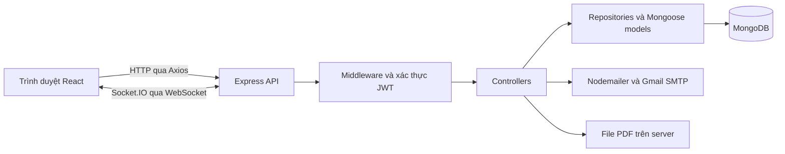

C&T Innovation Website

Website giới thiệu doanh nghiệp, sản phẩm và giải pháp công nghệ, tích hợp hệ thống quản trị nội dung và tiếp nhận liên hệ khách hàng.

1. Overview

Dự án tập trung thông tin doanh nghiệp, sản phẩm, giải pháp, dự án và tin tức trên một website. Khách truy cập có thể tìm hiểu dịch vụ và gửi yêu cầu tư vấn. Quản trị viên quản lý nội dung và theo dõi liên hệ qua giao diện riêng.

Mã nguồn gồm frontend React trong `client/` và backend Express trong `sever/`, lưu dữ liệu bằng MongoDB. Giao diện hỗ trợ tiếng Việt, tiếng Anh và chế độ sáng/tối.

2. Live Demo

Domain được cấu hình trong dự án là [www.thanhtoanct.com](https://www.thanhtoanct.com). Trạng thái hoạt động của website chưa được xác minh trong lần cập nhật README này.

Địa chỉ chạy cục bộ là `http://localhost:5173`. Trang đăng nhập quản trị nằm tại `/admin/login`.

3. Screenshots

Repository hiện chưa có bộ ảnh chụp giao diện được xác nhận để minh họa README. Các ảnh cần bổ sung gồm trang chủ, danh sách sản phẩm, chi tiết giải pháp, trang liên hệ và dashboard quản trị.

4. Features

- Giới thiệu doanh nghiệp, đội ngũ, khách hàng và chứng chỉ.
- Hiển thị danh sách, chi tiết sản phẩm, giải pháp và tin tức, cùng nội dung dự án và chính sách.
- Tiếp nhận liên hệ, yêu cầu đặt lịch và đăng ký nhận tin.
- Gửi email thông báo cho quản trị viên và xác nhận cho khách hàng.
- Đăng nhập quản trị bằng JWT và hỗ trợ khôi phục mật khẩu qua OTP email.
- Quản trị bài viết, sản phẩm, giải pháp, dự án, khách hàng, chính sách, người dùng và liên hệ.
- Upload tài liệu PDF và phục vụ file từ backend.
- Cập nhật nội dung qua Socket.IO tại các màn hình có đăng ký sự kiện.
- Chuyển ngôn ngữ Việt/Anh, giao diện sáng/tối và bố cục responsive.
- Slider, lightbox, animation và hiệu ứng cuộn trang.

5. Tech Stack

| Nhóm | Công nghệ |
| --- | --- |
| Frontend | JavaScript, JSX, React 18, React DOM, React Router 7, Context API |
| Giao diện | HTML, CSS, Tailwind CSS 3, React Icons, Google Fonts |
| Hiệu ứng | AOS, GSAP và ScrollTrigger, Framer Motion, Lenis, Swiper, FsLightbox, React CountUp |
| Kết nối | Axios, Socket.IO Client, WebSocket |
| Backend | Node.js, TypeScript 5, Express 4, Socket.IO |
| Database | MongoDB, Mongoose 8 |
| Xác thực | JSON Web Token, bcrypt, cookie-parser |
| Email và upload | Nodemailer, Gmail SMTP, Multer |
| Cấu hình | dotenv, cors, ES Modules |
| Tools | npm, Vite 6, PostCSS, Autoprefixer, ESLint, tsx, Nodemon, TypeScript Compiler, Git |
| Triển khai được hướng dẫn | Nginx, PM2, Certbot và Let's Encrypt |

Chi tiết dependency và phiên bản nằm trong `package.json` của từng thư mục. Các package như Cloudinary, amqplib và Sharp đã được khai báo nhưng chưa thấy được gọi trong mã ứng dụng đã rà.

6. Project Structure

Đường dẫn dưới đây tính từ thư mục gốc repository.

```text
C-T/
├── client/
│   ├── public/                 # Ảnh, video, tài liệu tĩnh
│   ├── src/
│   │   ├── api/                # Axios, API functions, Socket.IO
│   │   ├── Component1/         # Các phần giao diện trang chủ
│   │   ├── contexts/           # Ngôn ngữ và theme
│   │   ├── Main/               # Layout chính
│   │   ├── Pages/              # Trang công khai và quản trị
│   │   ├── Router/             # Routing và bảo vệ trang quản trị
│   │   ├── Shared/             # Component dùng chung
│   │   ├── utils/              # Bản dịch giao diện
│   │   └── main.jsx            # Entry point frontend
│   ├── .env.example
│   ├── package.json
│   └── vite.config.js
├── sever/
│   ├── src/
│   │   ├── controllers/        # Xử lý request
│   │   ├── models/             # Mongoose schema và model
│   │   ├── repositories/       # Truy cập dữ liệu
│   │   ├── routes/             # Khai báo API
│   │   ├── scripts/            # Seed và migration
│   │   ├── services/           # Logic dịch vụ hiện có
│   │   ├── utils/              # Middleware, database, email, socket
│   │   └── index.ts            # Entry point backend
│   ├── uploads/                # File được lưu trên server
│   ├── .env.example
│   └── package.json
├── SETUP.md
└── HUONG_DAN_CAI_DAT_EMAIL.md
```

7. Installation & Setup

Cần Node.js tương thích với Vite 6, npm và MongoDB. Có thể dùng Node.js 22 để đồng bộ với package Node được khai báo trong frontend.

### Tải mã nguồn

```sh
git clone https://github.com/kien-phung/C-T.git
cd C-T
```

### Chạy backend

```sh
cd sever
npm ci
```

Tạo `sever/.env` từ `sever/.env.example` nếu chưa có. Điền các biến ở mục tiếp theo, bảo đảm MongoDB có thể kết nối rồi chạy backend.

```sh
npm run dev
```

Backend chạy ở cổng được cấu hình bởi `PORT`. Frontend hiện mặc định kết nối cổng 4040.

### Chạy frontend

Mở terminal thứ hai từ thư mục gốc repository.

```sh
cd client
npm ci
npm run dev
```

Truy cập `http://localhost:5173`. Đăng nhập quản trị bằng thông tin `ROOT_EMAIL` và `ROOT_PASSWORD` của môi trường đang chạy. Backend có logic tạo tài khoản quản trị gốc khi đăng nhập bằng cặp thông tin này.

### Build và kiểm tra

| Thư mục | Lệnh | Mục đích |
| --- | --- | --- |
| `client` | `npm run build` | Build frontend vào `dist` |
| `client` | `npm run preview` | Xem bản build cục bộ |
| `sever` | `npm run build` | Biên dịch TypeScript vào `dist` |
| `sever` | `npx tsc --noEmit` | Kiểm tra kiểu dữ liệu |
| `sever` | `npm start` | Chạy backend bằng tsx |

Backend có các lệnh seed `npm run seed:blogs`, `npm run seed:products`, `npm run seed:solutions`, `npm run seed:policies` và migration `npm run migrate:features`. Đọc script và xác nhận cơ sở dữ liệu đích trước khi chạy.

Hướng dẫn triển khai và xử lý lỗi nằm trong [SETUP.md](SETUP.md).

8. Environment Variables

### Backend — `sever/.env`

```env
PORT=4040
NODE_ENV=development
CLIENT_URL=http://localhost:5173
DATABASE_MONGO_URL=mongodb://localhost:27017/c-t-database
EMAIL_USER=your-email@gmail.com
EMAIL_PASS=your-app-password
ROOT_EMAIL=admin@example.com
ROOT_PASSWORD=replace-with-your-password
JWT_SECRET=replace-with-your-secret
```

| Biến | Ý nghĩa |
| --- | --- |
| `PORT` | Cổng HTTP của backend |
| `NODE_ENV` | Chế độ development hoặc production |
| `CLIENT_URL` | Origin frontend được phép, phân cách bằng dấu phẩy |
| `DATABASE_MONGO_URL` | URI MongoDB |
| `EMAIL_USER`, `EMAIL_PASS` | Tài khoản gửi Gmail và mật khẩu ứng dụng |
| `ROOT_EMAIL` | Email quản trị gốc và địa chỉ nhận thông báo liên hệ |
| `ROOT_PASSWORD` | Mật khẩu đăng nhập quản trị gốc |
| `JWT_SECRET` | Khóa ký và xác minh token |
| `LOG_REQUESTS` | Tùy chọn, đặt `true` để ghi log request |
| `LOG_VERBOSE` | Tùy chọn, đặt `true` để tăng chi tiết log ngoài production |

### Frontend — các file `.env` của Vite

```env
VITE_API_URL=http://localhost:4040
VITE_API_BASE_PATH=/api
```

`VITE_API_URL` hiện được `vite.config.js` dùng làm đích proxy `/api` của dev server. `VITE_API_BASE_PATH` được khai báo trong mẫu nhưng chưa được mã nguồn sử dụng.

Axios và Socket.IO hiện tự chọn backend theo hostname trình duyệt trong `src/api/axiosClient.js` và `src/api/socket.js`. Hostname chứa `thanhtoanct.com` hoặc `yourdomain.com` dùng cùng origin. Các hostname khác dùng cùng hostname và cổng 4040. Khi triển khai domain khác, cần cập nhật logic này cho phù hợp.

9. API Documentation

Base URL khi chạy cục bộ là `http://localhost:4040/api`.

| Method | Endpoint | Chức năng | Xác thực |
| --- | --- | --- | --- |
| POST | `/contacts` | Tạo liên hệ và thực hiện gửi email | Công khai |
| GET | `/products` | Danh sách sản phẩm | Công khai |
| GET | `/products/:id` | Chi tiết sản phẩm | Công khai |
| GET | `/solutions` | Danh sách giải pháp | Công khai |
| GET | `/solutions/:slug` | Chi tiết giải pháp | Công khai |
| GET | `/blogs` | Danh sách bài viết | Công khai |
| GET | `/blogs/:id` | Chi tiết bài viết | Công khai |
| POST | `/admin/auth/login` | Đăng nhập quản trị | Công khai |
| POST | `/admin/auth/forgot-send-otp` | Yêu cầu OTP khôi phục mật khẩu | Công khai |
| POST | `/admin/auth/forgot-reset` | Đặt lại mật khẩu bằng OTP | Công khai |
| GET | `/admin/auth/me` | Thông tin quản trị viên hiện tại | JWT |
| GET | `/admin/contacts` | Danh sách liên hệ | JWT và kiểm tra quyền admin |
| GET | `/admin/contacts/stats` | Thống kê liên hệ | JWT và kiểm tra quyền admin |
| DELETE | `/admin/contacts/:id` | Xóa liên hệ | JWT và kiểm tra quyền admin |
| GET, POST | `/admin/products` | Liệt kê và tạo sản phẩm | JWT |
| PATCH, DELETE | `/admin/products/:id` | Sửa và xóa sản phẩm | JWT |

Các nhóm API khác được đăng ký trong `sever/src/routes/routes.ts`. Header xác thực có dạng `Authorization: Bearer <token>`.

Ví dụ body của `POST /contacts` dùng `Content-Type: application/json`.

```json
{
  "name": "Người dùng thử",
  "email": "test@example.com",
  "phone": "0900000000",
  "address": "TP. Hồ Chí Minh",
  "message": "Tôi muốn được tư vấn về sản phẩm.",
  "submit_type": "Contact Form",
  "language": "VN"
}
```

Backend trả HTTP 201 khi lưu liên hệ thành công. Lỗi gửi email được xử lý riêng trong controller. Các bước kiểm tra qua giao diện nằm trong [API_TEST_GUIDE.md](client/API_TEST_GUIDE.md).

10. Architecture



Backend dùng một HTTP server chung cho Express và Socket.IO. Các route nằm dưới `/api`, file upload được phục vụ dưới `/files`. Nhiều luồng CRUD đi qua controller đến repository hoặc model. Một số logic tài khoản được đặt trong `services`.

11. Challenges & Solutions

Các vấn đề kỹ thuật và cách xử lý được thể hiện trong mã nguồn hiện tại.

| Vấn đề | Cách xử lý |
| --- | --- |
| Nội dung thay đổi cần được phản ánh trên nhiều màn hình | Backend phát sự kiện Socket.IO, frontend đăng ký sự kiện để tải lại dữ liệu |
| Gửi form trên nhiều môi trường trình duyệt | Client thử URL-encoded, JSON và FormData, backend có bộ phân tích request tương ứng |
| Duy trì nội dung Việt/Anh | Context quản lý ngôn ngữ, bộ dịch giao diện và các trường dữ liệu song ngữ |
| MongoDB chưa sẵn sàng khi khởi động | Hàm kết nối có retry và timeout |
| Lỗi gửi email sau khi đã lưu liên hệ | Controller bắt lỗi từng lần gửi, giữ bản ghi liên hệ đã lưu |
| Upload PDF có MIME type thiếu hoặc khác dự kiến | Middleware xét MIME type và đuôi PDF, giới hạn file 30 MB |
| Điều phối animation theo cuộn | Kết hợp Lenis với GSAP ScrollTrigger và AOS |

12. My Contributions

Phạm vi đóng góp cá nhân cần được tác giả bổ sung dựa trên công việc thực tế. Repository hiện chưa có bảng phân công để xác nhận người phụ trách từng chức năng.

Khi hoàn thiện mục này, ghi rõ module đã trực tiếp thực hiện, vấn đề đã xử lý và dẫn đến commit hoặc pull request tương ứng.

13. Future Improvements

Các hướng cải tiến đề xuất dựa trên mã hiện tại, cần được xác nhận trước khi đưa vào kế hoạch phát triển.

- Thống nhất cấu hình địa chỉ Axios và Socket.IO qua biến môi trường.
- Chia nhỏ bundle bằng lazy loading theo route.
- Bổ sung kiểm thử cho đăng nhập, CRUD, upload và tiếp nhận liên hệ.
- Chuẩn hóa kiểm tra đầu vào và quyền truy cập giữa các nhóm API quản trị.
- Bổ sung cơ chế chống tạo liên hệ trùng khi client thử lại request.
- Đưa tác vụ gửi email vào hàng đợi có retry và theo dõi trạng thái.
- Rà dependency chưa dùng và cập nhật cấu hình lint.
- Bổ sung ảnh chụp giao diện và tài liệu API chi tiết.

14. Author

Repository được lưu trên tài khoản GitHub [kien-phung](https://github.com/kien-phung), theo remote `origin` của mã nguồn.

Tên tác giả và vai trò trong dự án cần được chủ repository xác nhận, bổ sung.

Source code tại [kien-phung/C-T](https://github.com/kien-phung/C-T).
