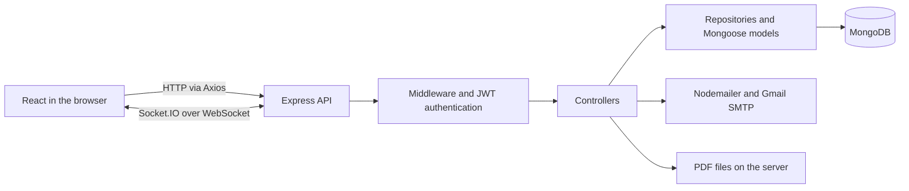

# C&T Innovation Website

A corporate website presenting the company, its products, and technology solutions, with content management and customer inquiry handling.

## 1. Overview

This project brings company information, products, solutions, projects, and news together on one website. Visitors can explore services and request a consultation. Administrators manage content and track customer inquiries through a dedicated interface.

The codebase consists of a React frontend in `client/` and an Express backend in `sever/`, with MongoDB for data storage. The interface supports Vietnamese, English, and light/dark themes.

## 2. Live Demo

The domain configured in the project is [www.thanhtoanct.com](https://www.thanhtoanct.com). The website's availability has not been verified during this README update.

The local development URL is `http://localhost:5173`. The administrator login page is available at `/admin/login`.

## 3. Screenshots

The repository does not yet include a confirmed set of interface screenshots for this README. Screenshots to add include the homepage, product listing, solution details, contact page, and administration dashboard.

## 4. Features

- Present company information, team members, customers, and certificates.
- Display product, solution, and news listings and details, along with project and policy content.
- Accept customer inquiries, appointment requests, and newsletter subscriptions.
- Send administrator notification emails and customer confirmation emails.
- Support administrator login with JWT and password recovery through email OTP.
- Manage articles, products, solutions, projects, customers, policies, users, and inquiries.
- Upload PDF documents and serve files from the backend.
- Update content through Socket.IO on screens that subscribe to events.
- Support Vietnamese/English switching, light/dark themes, and responsive layouts.
- Provide sliders, lightboxes, animations, and scrolling effects.

## 5. Tech Stack

| Category | Technologies |
| --- | --- |
| Frontend | JavaScript, JSX, React 18, React DOM, React Router 7, Context API |
| Styling | HTML, CSS, Tailwind CSS 3, React Icons, Google Fonts |
| Animations | AOS, GSAP and ScrollTrigger, Framer Motion, Lenis, Swiper, FsLightbox, React CountUp |
| Networking | Axios, Socket.IO Client, WebSocket |
| Backend | Node.js, TypeScript 5, Express 4, Socket.IO |
| Database | MongoDB, Mongoose 8 |
| Authentication | JSON Web Token, bcrypt, cookie-parser |
| Email and uploads | Nodemailer, Gmail SMTP, Multer |
| Configuration | dotenv, cors, ES Modules |
| Tools | npm, Vite 6, PostCSS, Autoprefixer, ESLint, tsx, Nodemon, TypeScript Compiler, Git |
| Deployment covered in the guide | Nginx, PM2, Certbot, Let's Encrypt |

Dependency details and versions are listed in each directory's `package.json`. Packages such as Cloudinary, amqplib, and Sharp are declared, but no calls to them were found in the reviewed application code.

## 6. Project Structure

The paths below are relative to the repository root.

```text
C-T/
├── client/
│   ├── public/                 # Images, videos, and static documents
│   ├── src/
│   │   ├── api/                # Axios, API functions, Socket.IO
│   │   ├── Component1/         # Homepage sections
│   │   ├── contexts/           # Language and theme
│   │   ├── Main/               # Main layout
│   │   ├── Pages/              # Public and administration pages
│   │   ├── Router/             # Routing and protected admin routes
│   │   ├── Shared/             # Shared components
│   │   ├── utils/              # Interface translations
│   │   └── main.jsx            # Frontend entry point
│   ├── .env.example
│   ├── package.json
│   └── vite.config.js
├── sever/
│   ├── src/
│   │   ├── controllers/        # Request handling
│   │   ├── models/             # Mongoose schemas and models
│   │   ├── repositories/       # Data access
│   │   ├── routes/             # API routes
│   │   ├── scripts/            # Seeds and migrations
│   │   ├── services/           # Existing service logic
│   │   ├── utils/              # Middleware, database, email, socket
│   │   └── index.ts            # Backend entry point
│   ├── uploads/                # Files stored on the server
│   ├── .env.example
│   └── package.json
├── SETUP.md
└── HUONG_DAN_CAI_DAT_EMAIL.md
```

## 7. Installation & Setup

The project requires a Node.js version compatible with Vite 6, npm, and MongoDB. Node.js 22 can be used to match the Node package declared in the frontend.

### Clone the repository

```sh
git clone https://github.com/kien-phung/C-T.git
cd C-T
```

### Run the backend

```sh
cd sever
npm ci
```

Create `sever/.env` from `sever/.env.example` if it does not exist. Set the variables described in the next section, ensure MongoDB is accessible, and start the backend.

```sh
npm run dev
```

The backend listens on the port configured by `PORT`. The frontend currently connects to port 4040 by default.

### Run the frontend

Open a second terminal at the repository root.

```sh
cd client
npm ci
npm run dev
```

Visit `http://localhost:5173`. Log in as an administrator using the running environment's `ROOT_EMAIL` and `ROOT_PASSWORD`. The backend includes logic to create the root administrator account when these credentials are used to log in.

### Build and validation

| Directory | Command | Purpose |
| --- | --- | --- |
| `client` | `npm run build` | Build the frontend into `dist` |
| `client` | `npm run preview` | Preview the build locally |
| `sever` | `npm run build` | Compile TypeScript into `dist` |
| `sever` | `npx tsc --noEmit` | Run type checking |
| `sever` | `npm start` | Run the backend with tsx |

The backend provides seed commands through `npm run seed:blogs`, `npm run seed:products`, `npm run seed:solutions`, and `npm run seed:policies`, plus the migration command `npm run migrate:features`. Review each script and confirm the target database before running it.

Deployment and troubleshooting instructions are available in [SETUP.md](SETUP.md).

## 8. Environment Variables

### Backend — `sever/.env`

```env
PORT=4040
NODE_ENV=development
CLIENT_URL=http://localhost:5173
DATABASE_MONGO_URL=mongodb://localhost:27017/c-t-database
EMAIL_USER=your-email@gmail.com
EMAIL_PASS=your-app-password
ROOT_EMAIL=admin@example.com
ROOT_PASSWORD=replace-with-your-password
JWT_SECRET=replace-with-your-secret
```

| Variable | Description |
| --- | --- |
| `PORT` | Backend HTTP port |
| `NODE_ENV` | Development or production mode |
| `CLIENT_URL` | Allowed frontend origins, separated by commas |
| `DATABASE_MONGO_URL` | MongoDB connection URI |
| `EMAIL_USER`, `EMAIL_PASS` | Gmail sender account and app password |
| `ROOT_EMAIL` | Root administrator email and recipient of inquiry notifications |
| `ROOT_PASSWORD` | Root administrator login password |
| `JWT_SECRET` | Key used to sign and verify tokens |
| `LOG_REQUESTS` | Optional, set to `true` to enable request logging |
| `LOG_VERBOSE` | Optional, set to `true` for detailed logs outside production |

### Frontend — Vite `.env` files

```env
VITE_API_URL=http://localhost:4040
VITE_API_BASE_PATH=/api
```

`VITE_API_URL` is currently used by `vite.config.js` as the development server's `/api` proxy target. `VITE_API_BASE_PATH` is declared in the example file but is not currently used in the source code.

Axios and Socket.IO currently select the backend based on the browser hostname in `src/api/axiosClient.js` and `src/api/socket.js`. Hostnames containing `thanhtoanct.com` or `yourdomain.com` use the same origin. Other hostnames use the same hostname with port 4040. Update this logic when deploying to a different domain.

## 9. API Documentation

The local base URL is `http://localhost:4040/api`.

| Method | Endpoint | Function | Authentication |
| --- | --- | --- | --- |
| POST | `/contacts` | Create an inquiry and attempt email delivery | Public |
| GET | `/products` | List products | Public |
| GET | `/products/:id` | Get product details | Public |
| GET | `/solutions` | List solutions | Public |
| GET | `/solutions/:slug` | Get solution details | Public |
| GET | `/blogs` | List articles | Public |
| GET | `/blogs/:id` | Get article details | Public |
| POST | `/admin/auth/login` | Log in as an administrator | Public |
| POST | `/admin/auth/forgot-send-otp` | Request a password recovery OTP | Public |
| POST | `/admin/auth/forgot-reset` | Reset a password using an OTP | Public |
| GET | `/admin/auth/me` | Get the current administrator's information | JWT |
| GET | `/admin/contacts` | List inquiries | JWT and admin role check |
| GET | `/admin/contacts/stats` | Get inquiry statistics | JWT and admin role check |
| DELETE | `/admin/contacts/:id` | Delete an inquiry | JWT and admin role check |
| GET, POST | `/admin/products` | List and create products | JWT |
| PATCH, DELETE | `/admin/products/:id` | Update and delete products | JWT |

Additional API groups are registered in `sever/src/routes/routes.ts`. The authentication header uses the format `Authorization: Bearer <token>`.

Example request body for `POST /contacts` with `Content-Type: application/json`.

```json
{
  "name": "Test User",
  "email": "test@example.com",
  "phone": "0900000000",
  "address": "Ho Chi Minh City",
  "message": "I would like a product consultation.",
  "submit_type": "Contact Form",
  "language": "VN"
}
```

The backend returns HTTP 201 when the inquiry is saved successfully. Email delivery errors are handled separately in the controller. Steps for testing through the interface are available in [API_TEST_GUIDE.md](client/API_TEST_GUIDE.md).

## 10. Architecture



The backend shares one HTTP server between Express and Socket.IO. Routes are mounted under `/api`, and uploaded files are served under `/files`. Many CRUD operations pass through controllers to repositories or models. Some account logic is placed in `services`.

## 11. Challenges & Solutions

The following technical challenges and approaches are reflected in the current source code.

| Challenge | Approach |
| --- | --- |
| Reflecting content changes across multiple screens | The backend emits Socket.IO events, and subscribed frontend screens reload their data |
| Submitting forms across browser environments | The client attempts URL-encoded, JSON, and FormData requests, with corresponding backend request parsers |
| Maintaining Vietnamese and English content | Language context, interface translations, and bilingual data fields |
| MongoDB being unavailable at startup | Connection retries and timeouts |
| Email delivery failing after an inquiry is saved | The controller catches each delivery error while retaining the saved inquiry |
| PDF uploads with missing or unexpected MIME types | Middleware checks MIME types and PDF extensions, with a 30 MB file limit |
| Coordinating scroll animations | Lenis is integrated with GSAP ScrollTrigger and AOS |

## 12. My Contributions

The author should complete this section based on their actual work. The repository currently has no task allocation document confirming ownership of individual features.

Describe the modules you implemented, the problems you resolved, and the corresponding commits or pull requests.

## 13. Future Improvements

The following improvements are proposed based on the current code and require confirmation before becoming part of the development plan.

- Unify Axios and Socket.IO URL configuration through environment variables.
- Split the bundle using route-based lazy loading.
- Add tests for authentication, CRUD operations, uploads, and inquiry submission.
- Standardize input validation and access control across administration APIs.
- Prevent duplicate inquiries when the client retries requests.
- Move email delivery to a queue with retries and status tracking.
- Review unused dependencies and update the lint configuration.
- Add interface screenshots and detailed API documentation.

## 14. Author

The repository is hosted under the GitHub account [kien-phung](https://github.com/kien-phung), according to the source code's `origin` remote.

The repository owner should confirm and add the author's name and project role.

Source code is available at [kien-phung/C-T](https://github.com/kien-phung/C-T).
